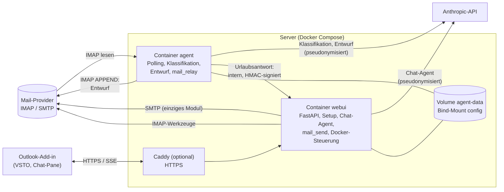

# Vizpatch

[](https://github.com/EnverShala/vizpatch-public/actions/workflows/ci.yml)

*English: Vizpatch is a lean, self-hosted AI email agent (Python, Docker, IMAP, Anthropic LLM). It classifies incoming mail and prepares reply drafts in the IMAP drafts folder; a human reviews and sends. This repository is published source-available for inspection only (see [LICENSE](LICENSE)).*

Vizpatch ist ein schmaler, selbst gehosteter KI-Email-Agent. Eingehende Mails werden auf Kundenanfragen klassifiziert; für jede relevante Mail entsteht ein Antwort-Entwurf im IMAP-Entwürfe-Ordner. Der Betreiber prüft im normalen Mail-Programm und sendet selbst.

## Was es tut

- Der **Agent** pollt das Postfach, klassifiziert Mails, erzeugt Entwürfe mit Firmenwissen aus `context.md` und legt sie per IMAP-APPEND ab.
- Die **WebUI** konfiguriert alles im Browser, steuert die Container und bietet einen Chat-Agenten mit Werkzeugen (Mails lesen, sortieren, Ordner, Anhänge, Versand nach Freigabe).
- Das **Outlook-Add-in** bringt die Chat-Pane in Outlook.
- Eine optionale **Urlaubs-Autoantwort** beantwortet Mails im eingetragenen Zeitraum.

## Architektur



## Sicherheits-Invarianten

- **Kein Auto-Send in der Entwurfs-Pipeline.** Der Agent legt nur Entwürfe ab und importiert kein SMTP; ein Drift-Test sichert das ab.
- **Chat-Versand nur nach Vorschau und Freigabe** in einem späteren Request, mit dem Vorschau-Token genau dieser Vorschau. Abschaltbar.
- **Urlaubs-Autoantwort** ist die einzige selbstständige Antwort. Sie hat vier Riegel (Schalter, gültiger Zeitraum, vorhandene Vorlage, Probelauf), geht über genau ein HTTP-Modul des Agents an die WebUI und wird von einem Wächter-Test abgesichert.
- **PII-Pseudonymisierung** vor LLM-Aufrufen (Regex für IBAN und Kreditkarten, standardmäßig an).
- **CI-Wächter:** gitleaks (Secrets), Trivy (Images), `check-actions-pinned.sh` (Actions per Commit-SHA), `check-no-dist-token.sh`, `check-image-content.sh`, Add-in-No-Autosend-Wächter. Details in [docs/ci.md](docs/ci.md).

## Repo-Aufbau

| Pfad | Inhalt |
|---|---|
| `agent/` | Polling-Agent (Python) |
| `webui/` | Browser-UI und Chat-Agent (FastAPI) |
| `outlook-addin/` | Outlook-Add-in (VSTO) |
| `deployment/` | Compose-Vorlage und Installationsanleitungen |
| `scripts/` | Test-, Wächter- und Hilfsskripte |
| `tests/` | Shell-Tests der Skripte |
| `docs/` | Dokumentation (CI) |

## Tests lokal

```
bash scripts/ci-test.sh <agent|webui|shell|guards|ruff|all>
bash scripts/linux-probelauf.sh
```

## Lizenz

Source-available, **keine Nutzungserlaubnis**: Der Quellcode darf eingesehen werden, alle übrigen Rechte bleiben vorbehalten. Siehe [LICENSE](LICENSE). Fremdkomponenten: [THIRD_PARTY_NOTICES.md](THIRD_PARTY_NOTICES.md). Sicherheitslücken bitte gemäß [SECURITY.md](SECURITY.md) melden.

## Hinweis zu Beiträgen

Dieses Repo ist ein Export aus einem privaten Repo. Pull Requests werden nicht direkt übernommen.
